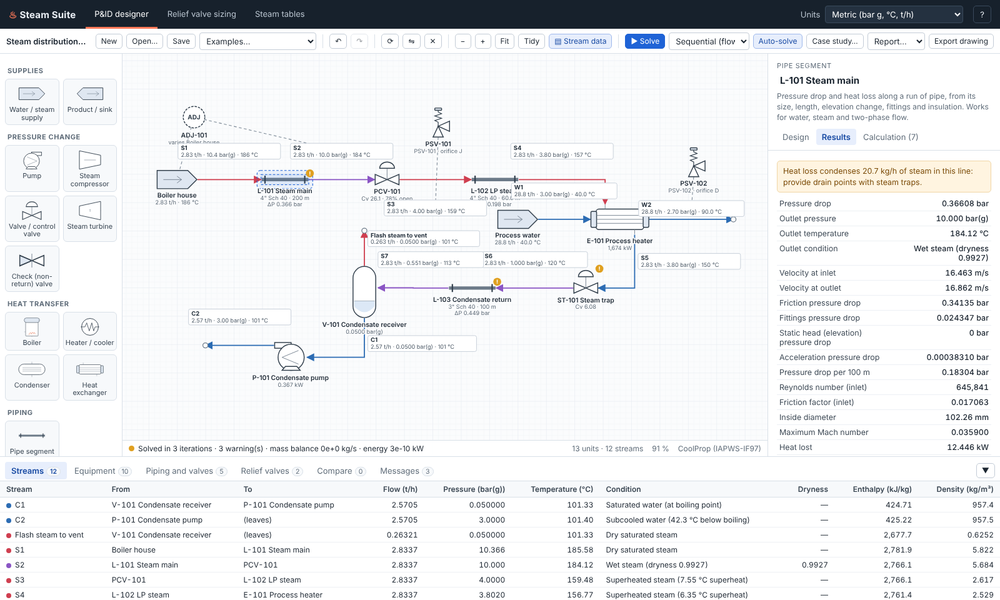
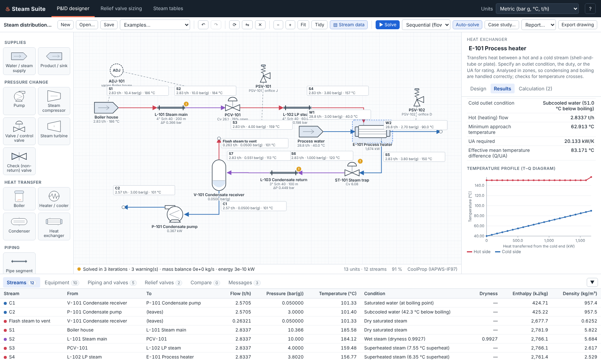
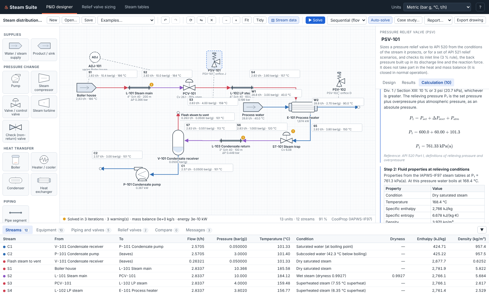
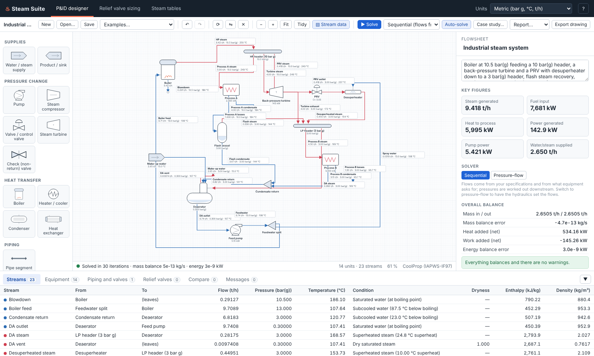
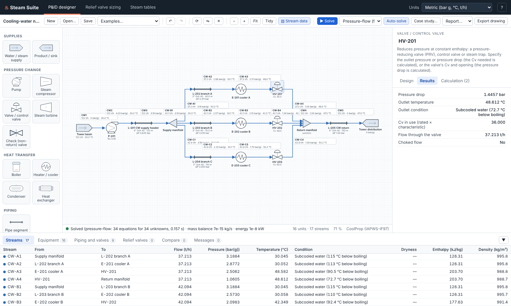
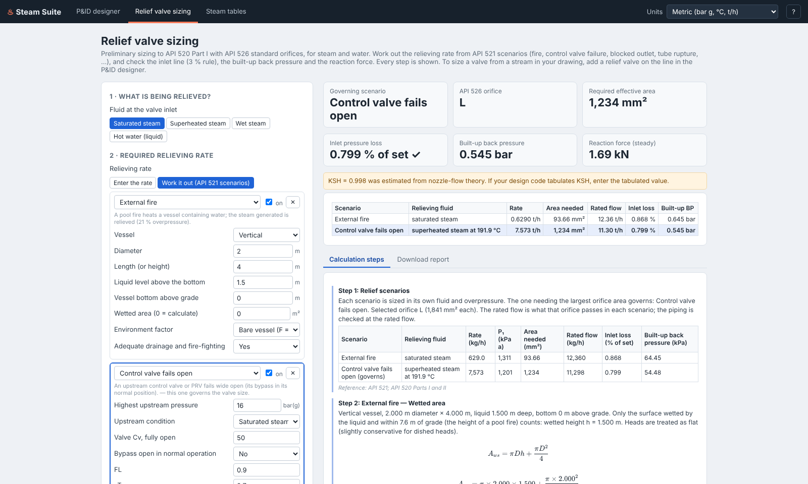
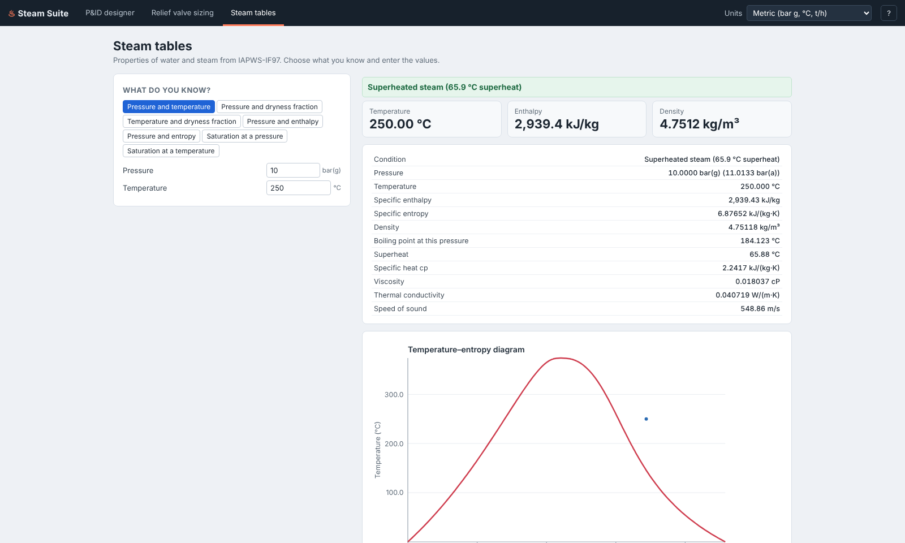

# Steam Suite

A **P&ID designer and steady-state simulator for water and steam systems**, in the spirit of Aspen HYSYS but
focused on water and steam. Draw the plant by dragging equipment onto a P&ID and connecting nozzles; the
simulator calculates the heat and mass balance and the pipe pressure drops as you draw, and in pressure–flow
mode it solves the hydraulics too: parallel branches share the flow, pumps run on their curves and trap back
pressures are found. It sizes control valves and relief valves, working out the relieving rate from API 521
scenarios. Every result can be opened to show the equations used, with the numbers substituted.



## What it does

| Area | Capabilities |
|---|---|
| **P&ID drawing** | Drag-and-drop palette of ISA-style symbols; connect nozzles by dragging; orthogonal pipe routing you can adjust; move, rotate, flip, copy/paste, duplicate, delete; undo/redo; pan and zoom; automatic tidy layout; stream data tags on every line (draggable); lines coloured by phase (steam, wet steam, water); export the drawing as SVG |
| **Heat and mass balance** | Solves automatically after every change. Handles recycle loops and "as required" flows (a deaerator works out its heating steam and make-up water, a header asks its balancing supply for the shortfall, a condensing heater finds its steam flow). Overall mass and energy balance checks |
| **Pressure–flow network** | Optional mode in which every stream's flow and pressure are solved together (Newton's method): flows divide between parallel branches by their resistance, pumps run where their curve meets the system, steam-trap back pressures come from the return line, PRVs go wide open when the supply is too low, check valves close against back-flow, closed loops with an expansion tank circulate. Missing or conflicting specifications are explained in plain words |
| **Pressure drop** | Pipe segments: ASME B36.10M sizes and schedules, length, elevation change, roughness, Crane TP-410 fittings and valves, insulation heat loss. Water, steam (compressible, with exact choking) and two-phase flow (Müller-Steinhagen & Heck, Friedel, Chisholm or homogeneous, compared side by side; homogeneous or drift-flux void fraction; design factor). Velocity, Mach number and erosional velocity checks; condensate formed by heat loss; flashing |
| **Valves and pumps** | Control valves: Cv required and opening (IEC 60534), or the pressure drop from a given Cv and opening; choked flow, flashing and cavitation checks. Pumps: outlet pressure, pressure rise or a pump curve; NPSH available vs required |
| **Heat exchangers** | Two-stream exchanger analysed in zones (correct for condensing and boiling); specify an outlet temperature, dryness, duty, UA (rating) or minimum approach; condensing-heater mode; temperature–duty (T–Q) diagram; temperature-cross detection |
| **Relief valves** | Place a PSV on any line: it is sized to API 520 from that line's conditions, with an API 526 orifice. The relieving rate can come from API 521 scenarios (fire, control valve failure, blocked outlet, tube rupture, thermal expansion, loss of cooling, abnormal heat input, boiler MCR), taking values from equipment on the drawing; the largest required area governs. Inlet line 3 % check, built-up back pressure in the discharge line (choked exits found exactly) and reaction force (API 520 Part II). A stand-alone relief sizing page covers saturated, superheated and wet steam, and hot water including flashing |
| **HYSYS-style tools** | Adjust (goal seek: vary one setting to hit a target); Specification (fix a flow or pressure in pressure–flow mode); Case study (vary a setting over a range, table, charts and CSV); workbook of streams, equipment, piping and relief valves; **Compare** tab: paste HYSYS or plant results and see the difference for every stream; downloadable calculation reports (HTML/Markdown) |
| **Properties** | IAPWS-IF97 steam tables page with a temperature–entropy chart |

Units: metric (bar g, °C, t/h), metric absolute, SI (kPa a, kg/s) or US customary (psig, °F, lb/h).

### Equipment

Water/steam supply (or expansion tank) · Product / sink · Pump · Steam compressor · Valve / control valve /
steam trap · Check (non-return) valve · Steam turbine · Boiler · Heater/cooler · Heat exchanger · Condenser ·
Pipe segment · Mixer · Splitter · Steam header · Flash vessel · Desuperheater · Deaerator / open feedwater
heater · Process steam user · Pressure relief valve (PSV) · Adjust (goal seek) · Specification

> **Important:** these are preliminary engineering calculations. Results used for design, and especially for
> pressure relief, must be checked by a qualified engineer against the codes and editions that apply to your
> equipment, using manufacturers' certified data.

## Getting started

```bash
cd steam-suite
python -m pip install -r requirements.txt
python -m steamsuite.web
```

Your browser opens at http://localhost:8000 with an example loaded. Then:

1. **Draw**: drag equipment from the palette on the left onto the drawing (or click an item, then click the
   drawing).
2. **Connect**: hover over a unit to see its nozzles. Drag from an outlet (filled dot) to an inlet (open dot).
   Drag an outlet into empty space for a stream leaving the system; drag an inlet into empty space to create a
   water/steam supply.
3. **Set up**: click a unit or line and fill in its settings on the right. Right-click a line to insert a pipe
   segment, valve, heater or relief valve.
4. **Read the results**: the drawing, the workbook (bottom) and each unit's **Results** and **Calculation** tabs
   update after every change. Press **?** in the top bar for all shortcuts.
5. **Let the hydraulics decide the flows** (optional): switch the solver in the toolbar from *Sequential* to
   *Pressure–flow*. Supplies set to "As required" then deliver whatever the pressures drive; splitter outlets
   can be "Pressure-driven"; give a sink a pressure where the water ends up. The status bar shows the
   equation count, and any missing or extra specification is named.
6. **Save** the flowsheet (.json), **Export drawing** (.svg) and download a **Report**.

Keyboard: `Del` delete · `R` rotate · `F` flip · `Ctrl+D` duplicate · `Ctrl+C`/`Ctrl+V` copy/paste ·
`Ctrl+Z`/`Ctrl+Y` undo/redo · mouse wheel zoom · right/middle-drag pan · `0` fit to window.

Your work is saved in the browser automatically, and restored when you come back.

## Screenshots

| Heat exchanger T–Q diagram | Relief valve on the P&ID, sized from its line |
|---|---|
|  |  |





| Relief valve with API 521 scenarios, inlet and discharge piping | Steam tables |
|---|---|
|  |  |

## Examples included

- **Steam distribution with pipes and relief valves**: boiler house, 200 m insulated steam main, PRV station,
  process heater, steam trap, flashing two-phase condensate return lifted 5 m, receiver and pump. Two relief
  valves, and an Adjust that finds the boiler pressure needed for 10 bar(g) at the end of the main.
- **Industrial steam system**: boiler, two headers, back-pressure turbine, PRV and desuperheater, flash steam
  recovery, condensate return, deaerator.
- **Cooling-water network (pressure–flow)**: a pump on its curve feeding three coolers in parallel through
  balancing valves; the flows divide by hydraulics.
- **Condensate return with trap back pressure (pressure–flow)**: three steam users draining through traps into
  a lifted, flashing return line; each trap's back pressure is worked out from the receiver.
- **Closed hot-water heating loop (pressure–flow)**: circulating pump, boiler exchanger, two circuits in
  parallel, expansion tank.
- **Rankine cycle with closed feedwater heater**.
- **Simple and regenerative Rankine cycles**, which match textbook results.

## Using the library from Python

```python
from steamsuite.examples import steam_distribution

fs = steam_distribution()
fs.solve()
print(fs.blocks["L-101 Steam main"].results["dP"].value, "kPa")   # pipe pressure drop
print(fs.blocks["PSV-101"].results["orifice"].value)               # API 526 orifice
print(fs.report().to_markdown())                                   # full calculation report
```

```python
from steamsuite.relief import ReliefInput, size_relief_valve

res = size_relief_valve(ReliefInput(fluid="saturated_steam", flow_kg_h=10_000, set_pressure_kpag=1_000))
print(res.orifice, round(res.required_area_mm2))   # L 1626
```

```python
from steamsuite.examples import cooling_water_network

fs = cooling_water_network()          # fs.solver_mode == "pressure_flow"
res = fs.solve()
print(res.network["equations"], "equations")
print({k: round(fs.streams[k].m * 3.6, 1) for k in ("CW-A1", "CW-B1", "CW-C1")}, "t/h")   # the split
```

```python
from steamsuite.relief import ReliefInput
from steamsuite.relief_system import LineSpec, size_relief_system

res = size_relief_system(
    ReliefInput(fluid="saturated_steam", flow_kg_h=0, set_pressure_kpag=1_000),
    scenarios=[{"type": "fire", "diameter": 2.0, "length": 4.0, "level": 1.5},
               {"type": "cv_failure", "upstream_pressure": 1_701.325, "cv": 50.0}],
    inlet=LineSpec("4", "40", length=1.0), outlet=LineSpec("6", "40", length=6.0))
print(res.governing.scenario.title, res.orifice, res.governing.inlet.percent, res.reaction.force_n)
```

The web app talks to the same library through a small JSON API (`/api/solve`, `/api/relief`,
`/api/relief-system`, `/api/compare`, `/api/properties`, `/api/case-study`, ...). See
`steamsuite/web/server.py`.

## Project layout

```
steam-suite/
├── steamsuite/
│   ├── water.py          IAPWS-IF97 properties (CoolProp fast path, iapws fallback)
│   ├── hydraulics.py     pipe friction, fittings, two-phase flow, choking, heat loss, control valves
│   ├── exchanger.py      zone analysis of two-stream heat exchangers
│   ├── relief.py         relief valve sizing (API 520 / 526)
│   ├── scenarios.py      relieving rates from API 521 scenarios
│   ├── relief_system.py  scenarios + inlet loss, built-up back pressure, reaction force
│   ├── compare.py        reads pasted HYSYS / plant results and compares them
│   ├── report.py         step-by-step calculation reports
│   ├── examples.py       example flowsheets
│   ├── flowsheet/        equipment models, solvers (sequential and pressure–flow network), Adjust,
│   │                     case studies, auto-layout
│   └── web/              FastAPI server and the browser app (plain JavaScript and SVG, no build step)
├── tests/                pytest suite, plus tests/e2e/designer_e2e.mjs (browser test)
└── docs/                 METHODS.md (equations), VALIDATION.md (checks), screenshots
```

## Tests

```bash
python -m pytest                                   # 170 tests: properties, hydraulics, equipment, solvers, relief, API
python -m steamsuite.web --no-browser &            # then, with Playwright installed:
node tests/e2e/designer_e2e.mjs                    # 48 browser checks: drawing, editing, pressure–flow, relief, compare, ...
```

See [docs/VALIDATION.md](docs/VALIDATION.md) for what each check compares against.

## Scope and limitations

- **Water and steam only, by design** (no dissolved gases, glycols or other fluids). Everything, including
  two-phase flow and relief, uses IAPWS-IF97.
- **Steady state only** (no dynamics, start-up or control loops).
- Two-phase pressure-drop correlations are typically accurate to about ±30 %. Four methods are available and
  compared in each pipe's report, with a design factor for margin.
- Relief: closed relief-header networks (several valves discharging into one header at once) are not
  modelled; a header is represented by its superimposed back pressure. The reaction force is the steady
  value; transient loads are covered only by the usual dynamic load factor.
- Not yet compared against a commercial simulator for a specific plant: use the Compare tab to check your
  own HYSYS case or plant data.
