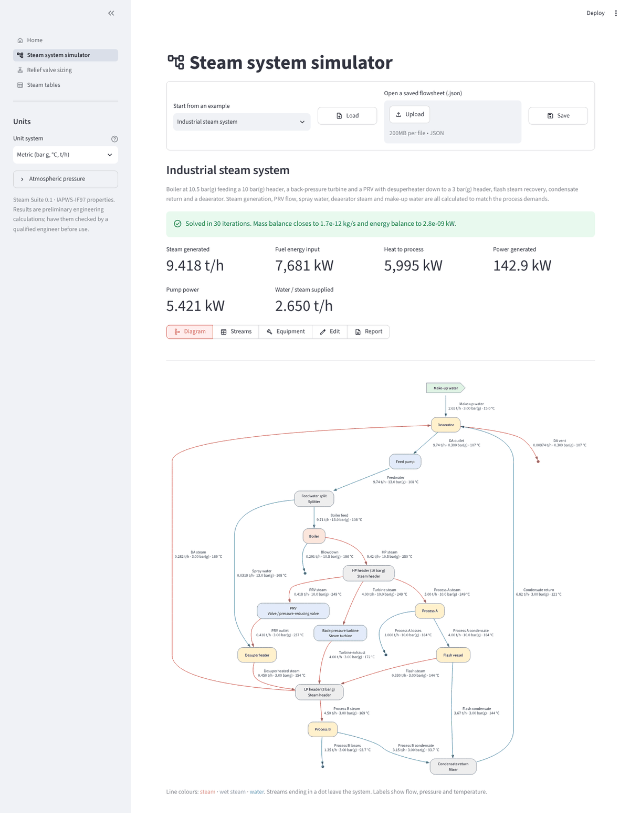
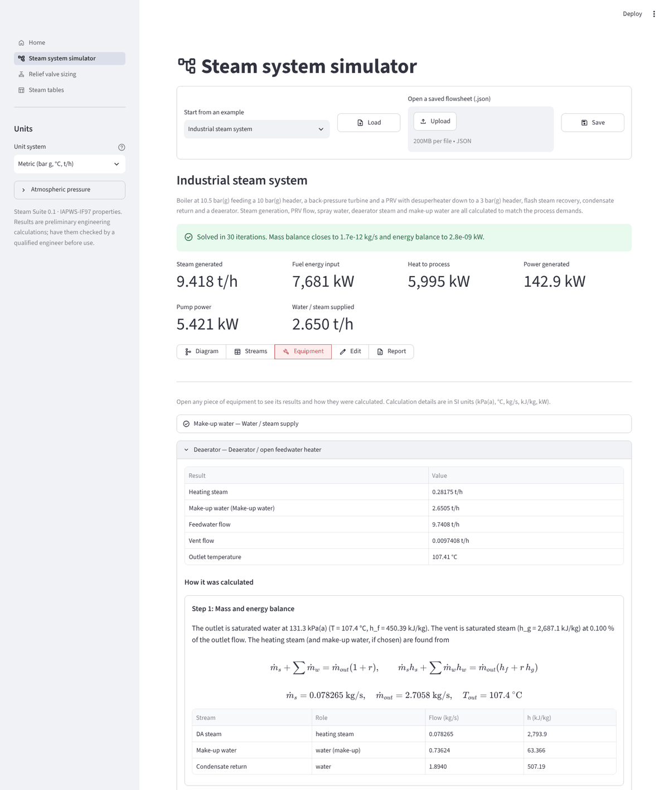
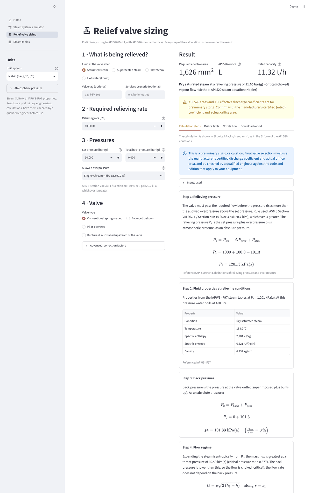

# Steam Suite

Engineering tools for **water and steam systems**, with every calculation shown step by step:

| Tool | What it does |
|---|---|
| **Steam system simulator** | Build a plant from boilers, steam headers, turbines, pressure-reducing valves, desuperheaters, flash vessels, deaerators, pumps, heaters, condensers and process steam users. Solves the steady-state mass and energy balance, including recycle loops and "as required" flows (steam generation, make-up water, PRV flow, spray water and deaerator steam are found automatically). |
| **Relief valve sizing** | Sizes pressure relief valves for saturated, superheated and wet steam, and hot water, including water that flashes to steam. API 520 Part I methods, API 526 orifice selection, and a printable step-by-step report. Any stream in the simulator can be sent straight to relief sizing. |
| **Steam tables** | Water and steam properties (IAPWS-IF97) from any two known values, with the state shown on a temperature–entropy chart. |

Units can be metric (bar g, °C, t/h), SI (kPa a, kg/s) or US customary (psig, °F, lb/h), or mixed.

> **Important:** these are preliminary engineering calculations. Results used for design, and especially for
> pressure relief, must be checked by a qualified engineer against the codes and editions that apply to your
> equipment, using the valve manufacturer's certified data.

## Quick start

```bash
cd steam-suite
python -m pip install -r requirements.txt
streamlit run app/streamlit_app.py
```

The app opens in your browser at http://localhost:8501. Then:

1. Pick your units in the sidebar.
2. Open **Steam system simulator**. The *Industrial steam system* example is loaded; explore the
   **Diagram**, **Streams** and **Equipment** views. Every piece of equipment shows how it was calculated.
3. Change something in **Edit** (e.g. a process steam demand) and watch the plant re-balance.
4. In **Streams**, pick a stream and click **Open in relief valve sizing**.
5. Download the calculation report (HTML or Markdown) from the **Report** view or the relief page.

## Screenshots

| Steam system simulator | Equipment calculations |
|---|---|
|  |  |
| **Relief valve sizing** | **Steam tables** |
|  |  |

## Using the library from Python

```python
from steamsuite.relief import ReliefInput, size_relief_valve

res = size_relief_valve(ReliefInput(
    fluid="saturated_steam", flow_kg_h=10_000, set_pressure_kpag=1_000))
print(res.orifice, round(res.required_area_mm2))   # L 1626
open("psv.html", "w").write(res.report.to_html())  # full step-by-step report
```

```python
from steamsuite.examples import industrial_steam_system

fs = industrial_steam_system()
fs.solve()
print(fs.summary()["steam_generated"] * 3.6, "t/h")  # 9.42 t/h
print(fs.report().to_markdown())
```

Flowsheets save to and load from JSON (`Flowsheet.to_json()` and `Flowsheet.from_json()`), the same files
the app's **Save** and **Open** buttons use.

## Equipment available

| Equipment | Calculates |
|---|---|
| Water / steam supply | Fixed flow, or "as required" by downstream equipment (e.g. make-up water) |
| Pump | Outlet state from isentropic efficiency; shaft and electrical power; head |
| Valve / pressure-reducing valve | Throttling at constant enthalpy; outlet superheat or flash fraction |
| Steam turbine | Isentropic efficiency; shaft and electrical power; exhaust wetness warning |
| Boiler | Saturated or superheated steam; heat duty; fuel input; blowdown |
| Heater / cooler | Outlet temperature, dryness fraction or heat duty |
| Condenser | Heat rejected; condensate subcooling; cooling water flow |
| Mixer | Mass and energy balance |
| Splitter | Outlets as fixed flow, %, "as required" or remainder |
| Steam header | Mixes supplies at header pressure; a balancing supply makes up the shortfall |
| Flash vessel | Flash steam and residual water at the vessel pressure |
| Desuperheater | Spray water needed to reach a target temperature or superheat |
| Deaerator / open feedwater heater | Heating steam (and make-up water) to produce saturated feedwater; vent |
| Process steam user | Steam flow or heat duty; condensate return % and subcooling |

## Project layout

```
steam-suite/
├── app/                    Streamlit user interface
│   ├── streamlit_app.py    entry point
│   ├── ui.py               shared widgets (units, reports)
│   └── views/              home, simulator, relief sizing, steam tables
├── steamsuite/             calculation library (no UI dependencies)
│   ├── water.py            IAPWS-IF97 properties
│   ├── relief.py           relief valve sizing
│   ├── report.py           step-by-step calculation reports
│   ├── units.py            unit conversions
│   ├── examples.py         example flowsheets
│   └── flowsheet/          simulator: equipment models and solver
├── tests/                  automated tests (pytest)
└── docs/
    ├── METHODS.md          equations and methods
    └── VALIDATION.md       checks against published values
```

## Tests

```bash
cd steam-suite
python -m pytest
```

The tests check the property library against the IAPWS-IF97 verification tables, the simulator against
textbook Rankine cycle examples, and the relief sizing against hand calculations with the API 520 equations.
See [docs/VALIDATION.md](docs/VALIDATION.md).

## Limitations (version 0.1)

- Steady state only. No dynamic simulation, start-up or control behaviour.
- Pure water and steam only. No dissolved solids, glycols or non-condensable gases.
- No pipe pressure-drop or heat-loss calculations yet. Pressure drops are entered per equipment.
- Relief sizing takes the required relieving rate as an input. Scenario analysis (API 521), inlet
  pressure-loss (3 %) checks, discharge piping and reaction forces are not yet included.
- The superheat correction factor KSH is estimated from nozzle-flow theory unless a code value is entered.
